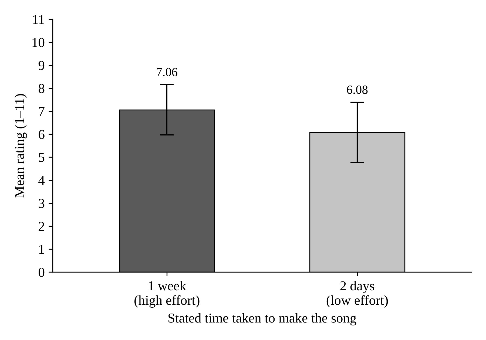

# Completed Workbook: Effort Heuristic Replication

**AT Psychology Group Project & Research Investigation Workbook, pages 2–10, filled in.**

**Sources (nothing else was used):**
1. The group's handwritten workbook pages, from the photos in [`original/Choosing_a_study_workbook.pdf`](original/Choosing_a_study_workbook.pdf) (transcribed in [`workbook-transcription.md`](workbook-transcription.md))
2. The data sheets in [`data/Effort_heuristic_data_collection.pdf`](data/Effort_heuristic_data_collection.pdf). Every statistic is computed from these sheets by [`data/analyze.py`](data/analyze.py); full working is in [`data/RESULTS.md`](data/RESULTS.md).

**How to read this page:**
- **Unmarked text** is what the group already wrote, tidied and kept in note form. Where it conflicted with what was actually run, it has been updated to the final design (e.g. 1 week / 2 days after the pilot), and the update is noted.
- **➕** marks content added here, built from the group's notes and the data sheets.
- **✏️ FILL IN** marks information that isn't in the workbook photos or the data sheets (e.g. actual ages, who made which material). **Only the group can supply these**, so nothing was invented.

The rating scale is **1–11** for both ratings (confirmed).

---

## Page 2: Choosing a study…

**Group Members**
- Sasha
- Leon
- Kyte ✏️ *(check spelling)*
- ✏️ FILL IN *(4th member, if any)*

**The study we are replicating is (full citation needed)…**
Kruger, J., Wirtz, D., Van Boven, L., & Altermatt, T. W. (2004). The effort heuristic. *Journal of Experimental Social Psychology, 40*(1), 91–98.
**Experiment 1**

| Original Study Being Replicated | *Write in note form.* |
|---|---|
| **Aim** | To test whether the time a poet supposedly spent on a poem influences how much people like it, how they judge its quality, and how much they think it's worth. |
| **Methods** | · 144 Williams College intro psych students (final N = 138: 89 women, 45 men, 4 undeclared) · Experiment, random allocation (independent measures) · All read the same poem · IV: half told it took **18 hrs**, half told **4 hrs** · Participants wrote details about the poem, then rated it · DVs: likeability, quality, monetary value |
| **Results** | · Liking and quality ratings significantly higher in the 18-hr condition than the 4-hr condition · Monetary value only marginally significant (*p* = .059) · Gender made no difference |
| **Conclusions** | People use perceived effort as a heuristic for the quality of something. |
| ➕ **Link to our replication** | Same phenomenon, tested with **songs** instead of a poem, **1 week vs 2 days** instead of 18 vs 4 hrs, **repeated measures** instead of independent groups, and **high school students** instead of university students. Monetary value dropped; liking and quality kept (the two DVs that were significant). |

➕ **Summary of the original study (~140 words; the form asks for 100–200):**
Kruger et al. (2004) investigated whether people use the effort that went into a piece of work as a shortcut for judging its quality. In Experiment 1, 138 introductory psychology students at Williams College read the same poem. Using random allocation, half were told the poet had spent 18 hours writing it and half were told 4 hours. After writing about the poem, participants rated how much they liked it, its quality, and its monetary value. Participants who believed the poem took 18 hours rated it significantly higher in both liking and quality than those told 4 hours. The difference in monetary value was only marginally significant (*p* = .059), and participant gender had no effect. The researchers concluded that people use perceived effort as a heuristic for quality: when quality is hard to judge directly, the effort invested is used in its place.

---

## Page 3: Background Research

**Theory or Model:** Heuristics, specifically the **effort heuristic**

**Summary of Theory/Model: Key Points** *(note form)*
- Heuristics = mental shortcuts; usually work, but can produce predictable errors.
- Attribute substitution: a hard question ("how good is this song?") is replaced with an easier one ("how much effort went into it?").
- Heuristics have stronger effects when there's **less information** or the judgement is **ambiguous**.
- Effort heuristic: perceived effort is used to judge quality (noted as related to the availability heuristic). ✏️ *Check this link against the article's introduction before using it in the report.*
- NOT cognitive dissonance: participants judge **someone else's** work, not their own effort.
- ➕ Link to the phenomenon: unfamiliar songs are hard to judge objectively, so a stated production time should shift ratings. Higher effort → higher perceived quality, even though the song is the same.

**Aims and Variables: Our Study**

- **Independent Variable:** Perceived effort in creating a song.
- **Dependent Variable:** Perceived quality of the song (overall likeability and quality rating).
- **Operational Definition of IV:** Each participant hears two songs (**SoR** and **CYFI**). One is described as taking **1 week** to make (high effort) and the other **2 days** (low effort).
  - Which song gets which label is counterbalanced.
  - Order is counterbalanced.
  - *Updated after the pilot: the original plan was 20 hrs vs 2 hrs.*
- **Operational Definition of DV:** The **mean of two ratings** given after each song:
  - **likeability** (1 = hate, 11 = love)
  - **quality** (1 = bad, 11 = great)
  - So each song gets one score from 1 to 11.

---

## Page 4: Hypotheses, Design, Sampling and Participants

### Hypotheses

**Research Hypothesis (H₁):** High school students will give a higher overall rating of likeability and quality (on a scale from 1–11) to a song they are told took **1 week** to make than to a song they are told took **2 days** to make.
*(Updated from 20 hrs / 2 hrs after the pilot.)*

**Null Hypothesis (H₀):** There will be no significant difference in the overall likeability and quality ratings between the song students are told took 1 week to make and the song they are told took 2 days to make; any difference is due to chance.

### Design

**Our Design:** Repeated measures + counterbalancing

**Explanation of why we chose this design:**
- Each participant hears both songs: one said to have taken 1 week to produce, the other 2 days.
- **Repeated measures** controls **participant variables** (e.g. music taste, general harshness or generosity in rating). Each participant is compared with themselves, unlike in independent measures.
- ➕ The anchor study (Exp. 1) used independent groups. Our workbook notes the repeated-measures version is very similar to Experiment 2 of the original article. Switching to repeated measures is one of our **modifications**.
- **Counterbalancing the labels** controls the **confounding variable** of song quality. If one song were always the "1 week" one, it might get higher ratings simply because it's an objectively better or more likeable song. Swapping the label controls for this.
- **Counterbalancing the order** in which the songs are heard controls **order effects**. The second song may be rated differently because of boredom, practice, etc.

### Sampling and Participants

**Our Sampling Method:** Convenience (opportunity) sampling of advisory groups. This would count as cluster sampling if advisories could be selected at random.

**Explanation of how we will get our sample:**
- Ask advisors at SAS if we can run the study during advisory.
- Test each advisory; all students in an advisory listen to the songs at the same time.
- Answer-sheet versions alternate, so half the students are told the first song took 2 days and half are told the second song took 2 days.
- Target: 4 advisories.

**Explanation of why we chose this method:**
1. **Practicality:** we had a short time window, and advisories let us gather enough data.
2. Advisories are presumably random mixes of students with varied backgrounds, which gives a more varied sample.
3. The original study used a similar convenience approach.
4. *Limitations (for evaluation):* only advisories whose advisor agreed were sampled; testing in a big group means participants may influence each other; convenience sampling limits generalization.

---

## Page 5: Characteristics of our Sample, Ethical Considerations

**Characteristics of our Sample**

| | Proposed | Actual (complete after expt.) |
|---|---|---|
| **Age** | 14–18 yrs old | ✏️ FILL IN *(age range, e.g. "14–17")* |
| **Gender** | Mixed (M & F) | ✏️ FILL IN *(e.g. "x female, y male")* |
| **Ethnicity** | Mixed (SAS population) | ✏️ FILL IN *(e.g. "mixed, SAS population")* |
| **Language** | Fluent English | ✏️ FILL IN *(confirm all fluent)* |
| **Other** | Not taking AT Psych | ➕ **N = 32** usable participants (4 data sheets × 8). ✏️ FILL IN: number of advisories tested, and how many AT Psych students joined but were excluded |

**Explanation of one characteristic:**
Participants should not be currently taking AT Psych. Students in the course likely already know about heuristics and may know about this study. They could guess that the stated time spent making the song is the IV and adjust their ratings to match their expectations. Excluding them controls for **demand characteristics**, so differences in the ratings are better explained by the IV.

### Ethical Considerations

| What we need to disclose | When we should disclose it |
|---|---|
| Advisor permission | Before (informed consent) |
| What the study is about, in general terms, with **no indication of effort/time** | Informed consent |
| How the experiment will work, in detail | Informed consent |
| It is voluntary; they can stop whenever they want | Informed consent |
| Confidentiality: answers private, no names | Informed consent |
| No harm will be done | Informed consent |
| **Deception**: the production times were made up | Debriefing |
| The true aim of the study | Debriefing |
| The real information about the songs | Debriefing |
| Right to withdraw their data | Debriefing |
| Request not to tell other advisories (protects later sessions) | Debriefing |
| Whether they guessed the aim of the study | Debriefing |

---

## Page 6: Procedures, Materials

### Notes on procedures

1. Agree a time with an advisory and its advisor.
2. Introduce ourselves and the study (general terms only). Hand out the informed consent form and collect it.
3. Participants sit apart and stay quiet. AT Psych students can join, but their data won't be used.
4. Hand out the two answer-sheet versions (X and Y) alternately, **face down**. Each sheet has a participant number.
5. Read the standardized instructions.
6. Participants flip their sheet over. It shows the song information, including the stated production time and **filler details**.
   - ➕ Pilot change: participants **write down** the additional info and the effort (time) info, so everyone reads it.
7. Play song 1; participants rate it (likeability 1–11, quality 1–11).
8. Play song 2; participants rate it the same way.
9. Collect the answer sheets.
10. Debrief: true aim, deception about the times, real song info, right to withdraw, ask them not to tell other advisories, ask whether they guessed the aim.
11. Thank everyone.

✏️ FILL IN for the Method section: how long each song played, how long participants had to rate, and which song was played first in each session.

### Materials

| Required Material | Group Member/s Responsibility |
|---|---|
| Informed consent form | ✏️ FILL IN |
| Standardized instructions | ✏️ FILL IN |
| Raw data collection table | ✏️ FILL IN |
| 2 songs (similar genre, style and duration): **SoR** and **CYFI** ✏️ *(full titles and artists)* | ✏️ FILL IN |
| 2 answer-sheet versions (X and Y) | ✏️ FILL IN |
| Debrief statement | ✏️ FILL IN |
| Advisory schedule | ✏️ FILL IN |

**Explanation of (at least) one material: answer sheets**
- **Two versions (X and Y):** version X says the first song took 2 days to make; version Y says the second song took 2 days. The rest is identical between versions.
- Handed out **alternately** to counterbalance which song carries which label. This controls for song quality as a confounding variable.
- **Filler details** on each sheet make it less obvious that time is the IV. This reduces **demand characteristics**.
- Sheets are handed out **face down**, so participants don't notice their paper differs from their peers'.
- ➕ Rating scales are printed with **anchors** (likeability: 1 = hate, 11 = love; quality: 1 = bad, 11 = great), so every participant interprets the scale the same way.

---

## Page 7: Pilot Study, Descriptive Statistics

**Pilot study completed?** Yes. *(The workbook lists changes made after the pilot.)*

**Notes on things we changed after pilot study:**
- Changed the stated production times from **2 hrs and 20 hrs** to **2 days and 1 week**, respectively.
- Made participants **write down** the additional info and the effort info, so they actually read it.
- *(The "changed genre?" note was crossed out, so the genre wasn't changed.)*

*The earlier handwritten descriptive figures (song 1: liking 4.75, quality 5.25; song 2: liking 7.5, quality 6.5) don't match the data sheets. They are not used below. If they are pilot results, record the pilot n; they may be useful in the evaluation.*

### Descriptive Statistics ➕

DV = mean of the likeability and quality ratings (1–11). N = 32, and every participant contributes one score to each condition.

| CALCULATIONS | Condition 1: **1 week** (high effort) | Condition 2: **2 days** (low effort) |
|---|---|---|
| **Central tendency**: Mean | ***M* = 7.06** | ***M* = 6.08** |
| *(also)* Median | 7.25 | 6.00 |
| **Dispersion**: Standard Deviation | ***SD* = 1.10** | ***SD* = 1.31** |
| *(also)* Range | 4.5 (4.5 to 9) | 6 (3 to 9) |
| Likeability only, *M* (*SD*) | 7.03 (1.20) | 6.09 (1.30) |
| Quality only, *M* (*SD*) | 7.09 (1.17) | 6.06 (1.50) |

➕ **From the data sheets' own statistics:** each sheet (8 participants) printed its condition means.

| Data sheet | Song labelled 1 week | Liking 1 wk | Quality 1 wk | Liking 2 d | Quality 2 d | Liking diff | Quality diff |
|---|---|---|---|---|---|---|---|
| 1 | SoR | 6.88 | 6.50 | 6.13 | 6.13 | 0.75 | 0.38 |
| 2 | CYFI | 7.25 | 7.38 | 6.25 | 6.13 | 1.00 | 1.25 |
| 3 | CYFI | 7.00 | 7.25 | 6.13 | 6.13 | 0.88 | 1.13 |
| 4 | SoR | 7.00 | 7.25 | 5.88 | 5.88 | 1.13 | 1.38 |

Every sheet shows the 1-week song rated higher on both measures. The sheets have equal n, so the overall means are the average of the sheet means.
- **Calculate the overall means from the raw scores (Σx ÷ 32), not from the rounded sheet means.**
- Averaging the rounded figures gives 6.10 and 6.07 for the 2-day condition, instead of the correct **6.09** and **6.06**.

### Statistics Findings Summary

| | |
|---|---|
| **Summary of how we measured our DV** | After listening to each song, participants rated it on two scales: likeability (1 = hate, 11 = love) and quality (1 = bad, 11 = great). Each participant's score for a song was the mean of the two ratings. |
| **Summary of results** | On average, participants rated the song described as taking 1 week higher (*M* = 7.06, *SD* = 1.10) than the song described as taking 2 days (*M* = 6.08, *SD* = 1.31), a difference of about 1 point on the 11-point scale. 27 of 32 participants rated the 1-week song higher, 3 gave equal scores, and 2 rated the 2-day song higher. The 2-day song's ratings were slightly more spread out. |
| **Interpretation based on hypothesis** | The results are in the direction predicted by H₁: the same songs were rated higher when described as taking more effort to make. The Wilcoxon test (p. 8) shows the difference is significant, so H₁ is supported. |

---

## Page 8: Graphing Data, Inferential Statistics

### Graphing Data ➕

Graph: [`data/figure1_mean_rating_by_effort.png`](data/figure1_mean_rating_by_effort.png). Regenerate it with `python3 study/data/make_figure.py`.

**Figure 1**
*Mean Combined Likeability and Quality Rating for Songs Described as Taking 1 Week or 2 Days to Make*
*Note.* Ratings are the mean of likeability and quality ratings (1–11). Error bars show ±1 standard deviation; *N* = 32.

Checklist:
- ✅ Title (APA: number in bold, title in italics above the figure)
- ✅ Both axes labelled
- ✅ Grayscale (no colour needed for printing)
- ✅ Appropriate graph: a bar chart of the two condition means
- ✅ Axes not distorted: the y-axis covers the full 1–11 scale and starts at 0

### Inferential Statistics ➕

**Our data is (circle one):** **related** / ~~unrelated~~ *(repeated measures: each participant rated under both conditions)*

**Our level of measurement is (circle one):** ~~nominal~~ / **ordinal** / ~~interval~~ / ~~ratio~~ *(rating scales; the gaps between points aren't guaranteed to be equal)*

**Therefore, our chosen test is:** **Wilcoxon signed-ranks test** (one-tailed, because H₁ is directional)

**If doing Wilcoxon Signed Ranks Test** *(our test)*

- **W value:** **18** (the smaller rank sum: + ranks = 417, − ranks = 18)
- **Critical value is:** **110** (one-tailed, *p* < .01). The critical value at *p* < .05 is 140. Based on **n = 29**: 32 participants minus 3 with tied scores, who are excluded.
- **P value:** ***p* < .01** (one-tailed)
- **Null hypothesis (circle one):** ~~accepted~~ / **rejected**

**If doing Mann-Whitney U Test** *(not our main test; this is the supplementary "between-student analysis" planned in the workbook)*

The same song is compared between students told "1 week" and students told "2 days", n = 16 per group, combined DV:

| Song | *U* value | Critical value (one-tailed, *p* < .05, n₁ = n₂ = 16) | Result |
|---|---|---|---|
| SoR | 77 | 83 | Significant (*p* < .05) |
| CYFI | 69.5 | 83 | Significant (*p* < .05) |

Null hypothesis for this check: **rejected** for both songs.

---

## Page 9: Written summaries

### Written summary of inferential statistics ➕

A one-tailed Wilcoxon signed-ranks test was used because the data were related (repeated measures design), the ratings were ordinal, and the hypothesis was directional.

Each participant's score for the 2-day song was subtracted from their score for the 1-week song. Three participants had no difference and were excluded, leaving n = 29. The absolute differences were ranked; positive differences had a rank sum of 417 and negative differences a rank sum of 18, so *W* = 18.

The critical value for n = 29 at *p* < .01 (one-tailed) is 110. *W* is less than or equal to the critical value, so the difference is significant (*p* < .01).

**The null hypothesis was rejected.** Participants rated the song significantly higher when told it took 1 week to make than when told it took 2 days.

*(Supporting results: the effect was also significant for likeability alone (W = 30, critical value = 84, n = 26, p < .01) and quality alone (W = 39, critical value = 140, n = 32, p < .01). Full ranking working is in [`data/RESULTS.md`](data/RESULTS.md), for Appendix E.)*

### Written summary of results ➕

| | |
|---|---|
| **How did the results of your study compare to the original?** | · **Same direction as Kruger et al. (2004):** the higher-effort version was rated higher in both liking and quality. The original found this with 18 vs 4 hrs; ours with 1 week vs 2 days. · Both liking and quality were significant in the original, and both were significant in ours (*p* < .01). · We had no monetary-value DV, so we can't compare the original's marginal (*p* = .059) result. · The effect was found with **songs** rather than a poem, with **high school** rather than university students, and in a **repeated-measures** design rather than independent groups. That suggests the effect extends beyond the original materials and sample. · The between-student check, which compares independent groups like the original, was also significant for both songs. · ✏️ To compare **effect size**, you need the original condition means from the article. They aren't in the workbook. Ours: about +1 point on an 11-point scale. |
| **What do your results relate to the original theory or model?** | · **Supports the effort heuristic:** the songs themselves didn't change, only the stated effort, yet ratings rose by about 1 point. Perceived effort was used as a shortcut for quality. · **Attribute substitution:** the songs were rated almost identically overall when the label is ignored (SoR 6.53, CYFI 6.61). That means the quality difference came from the label, not the music. The easier question ("how long did it take?") stood in for the harder one ("how good is it?"). · **Ambiguity:** these were unfamiliar songs that are hard to judge objectively, which is the kind of situation where heuristics are expected to be strongest. · The effect was **consistent but modest**: every individual liking or quality difference was between −1 and +2 points. The heuristic nudged judgements rather than overriding them. |

---

## Page 10: Evaluation ➕

Following the revised Discussion structure ([`../sources/discussion-structure-revised.md`](../sources/discussion-structure-revised.md)), each limitation names a specific flaw, links it to our numbers, and gives a concrete fix. At least one is about internal validity or reliability.

| Aspect | Strength | Limitation | Suggested Modifications |
|---|---|---|---|
| **Design** | **Repeated measures** controls participant variables (music taste, rating harshness), because each student is compared with themselves. **Counterbalancing the label** means song quality isn't a confound: when the labels are ignored, the two songs were rated almost identically (6.53 vs 6.61). | **Demand characteristics (internal validity).** Every participant saw both production times. The 1-week vs 2-day contrast may have revealed the aim, despite the filler details, and produced a uniform "expected" bump. Consistent with this, every individual difference was between −1 and +2, and 27 of 32 students moved in the same direction. | Run it as **independent measures**: each student hears one song with one label. The workbook's between-student check suggests the effect survives this (significant for both songs). Also, ask "what do you think the aim was?" on the answer sheet and **re-run the analysis without those who guessed**, as the workbook planned. |
| **Sample** | **AT Psych students' data excluded**, which reduces demand characteristics from students who know about heuristics. Advisories give a mix of backgrounds. | **Convenience sample of SAS advisories** (only where the advisor agreed). Every participant comes from one international school, and these are students used to judging music in a peer setting, so generalization is limited. ✏️ Add the actual age and gender split once filled in on p. 5. | Randomly select advisories (true cluster sampling) across grades. Record demographics on the answer sheet so the sample can be described and checked. |
| **Procedure** | **Standardized**: same instructions, songs played to the whole group at once, answer sheets face down. Pilot-tested: times changed to the more believable 2 days / 1 week, and participants copy down the effort info so everyone reads it. | **Inconsistent testing conditions across sessions (reliability).** Data sheet 1 shows a much weaker effect: mean combined difference 0.56, against 1.00–1.25 on the other sheets. It contains both participants who rated the 2-day song higher overall (S1-P3, S1-P8), and it's the only sheet not significant on its own. Something about that session (time of day, delivery of instructions, play order) may have differed. **Group testing** also lets participants influence each other. | Use a **recorded audio script** for instructions and fixed playback equipment. **Log** the session, advisory, answer-sheet version and play order on every sheet. Test in smaller groups or with headphones and seats spaced apart. |
| **Other** | **No ceiling or floor effect**: nobody used 10 or 11, and only one rating was below 3, so the scale had room to show differences. Liking and quality agree closely (ρ = .77), which supports averaging them into one DV. | **Liking and quality may not be judged separately** (a halo effect): the strong correlation suggests one overall impression. Also, play order and answer-sheet version weren't recorded on the data sheets, so **order effects can't be checked** even though order was counterbalanced. | Put the two rating questions on separate lines, with short descriptions of what "quality" means (e.g. production, musicianship) as opposed to personal liking. Add **"played first"** and **"version X/Y"** columns to the data table. |

---

## ✏️ Still to fill in (not in the photos or the data sheets)

1. **Actual sample characteristics** (p. 5): age range, gender split, ethnicity and language confirmation, number of advisories, number of AT Psych students excluded.
2. **Materials responsibilities** (p. 6): who made each material.
3. **Song details** (p. 6): full titles and artists for SoR and CYFI.
4. **Procedure details** (p. 6): song durations, rating time, which song was played first in each session.
5. **Which session each data sheet came from**, and whether anything differed in sheet 1's session (useful for the evaluation).
6. **Pilot n**, and whether the earlier handwritten figures were pilot data (p. 7).
7. **Original study's condition means**, from the article, for the effect-size comparison (p. 9).
8. **Who guessed the aim**, if the debrief recorded it, to run the planned re-analysis.
9. **4th group member's name**, and the spelling of "Kyte" (p. 2).
